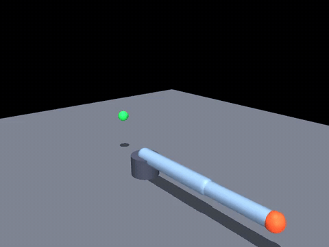

# mujoco-arm-lab

用 MuJoCo 从零搭建一台三自由度机械臂，实现**阻尼最小二乘逆运动学（DLS-IK）**控制末端到达随机目标点。
不依赖任何硬件，Windows 原生可运行。



绿球是随机生成的目标点，橙红色小球是机械臂末端执行器（site `ee`）。

## 实测结果

50 个随机目标点，判据：末端位置误差 < 5 mm，单次最多 8 s 仿真时间。

| 指标 | 结果 |
|---|---|
| 到达成功率 | **100%**（50/50） |
| 平均末端误差 | **0.34 cm** |
| 最差末端误差 | 0.49 cm |
| 平均收敛耗时 | 2.74 s（仿真时间） |

### 换个工况，成功率掉 17 个百分点

上面那个 100% 有个隐含前提：**每个目标点都从初始姿态重新开始**。
改成连续作业、不重置姿态（`scripts/03_interactive_viewer.py` 的场景）后：

| 指标 | 逐轮重置（02） | 连续作业（03） |
|---|---|---|
| 成功率 | 100%（50/50） | **82.8%**（303/366） |
| 平均末端误差 | 0.34 cm | 0.40 cm |
| 平均收敛耗时 | 2.74 s | 1.80 s |

20 分钟仿真时间的统计结果。失败的 63 次全部是「超时」而不是「走得不够准」：
机械臂从上一个目标点的姿态出发时，会陷在局部极小或贴住关节限位附近出不来，
单目标超过 8 s 就换下一个。

**同一个控制器，只因评测工况不同，成功率就从 100% 掉到 83%。**
所以报成功率时必须写清「是否每轮重置」，否则数字没有可比性 —— 这是做 benchmark 最容易踩的坑之一。

## 从 IK 蒸馏出一个神经网络策略

强化学习在这个任务上没跑通（原因见下一节），于是换了一条路：
**让神经网络模仿 IK 专家的动作**（行为克隆）。目标同样是「学出一个能控制机械臂的策略」。

做法：用 IK 跑 300 条专家轨迹 → 采集 12.5 万条 (观测, 动作) 样本 → 用 MSE 监督学习
训一个 10→256→256→3 的 MLP。

### 结果

| 方法 | 成功率 | 平均误差 | 最差误差 | 平均耗时 | 超时 | 算一次控制指令 |
|---|---|---|---|---|---|---|
| IK（解析解） | 50/50 = **100%** | 0.34 cm | 0.49 cm | 2.74 s | 0 | **8.7 μs** |
| BC（神经网络） | 49/50 = **98%** | 0.32 cm | 0.92 cm | 2.90 s | 1 | 58.2 μs |

### 两个反直觉的发现

**一、训练 MSE 更高的模型，实际成功率反而高得多。**

| 专家数据 | 训练 MSE | 成功率 | 最差误差 |
|---|---|---|---|
| 只含 IK 的干净轨迹 | 5.4e-3（更低） | **62%** | 49.57 cm |
| 额外注入随机扰动 | 1.07e-2（更高） | **98%** | 0.92 cm |

干净轨迹训出来的模型拟合得更准，但一上考场就迷路 —— 这叫**复合误差**：
策略一旦偏离专家轨迹，就进入训练时没见过的状态，然后越错越远。
注入扰动让专家演示「如何从偏离状态纠正回来」，把失败率从 38% 压到 2%。

**决定泛化能力的是数据覆盖范围，不是拟合精度。**

**二、神经网络推理比解析求解慢了近 7 倍。**

IK 算一次控制指令只要 **8.7 μs**（一次雅可比计算 + 一个 3×3 线性方程），
BC 网络前向要 **58.2 μs**。一个小 MLP 在这个问题规模上并不划算。

也就是说，**「用深度学习替代经典控制器」不是默认正确的选择**：
自由度低、模型已知的场景里，解析方法既准又快。

## 为什么没用强化学习

结论：**试了，在这台机器上跑不通**。记录在这里免得以后重复踩。

| 算法 | 结果 | 原因 |
|---|---|---|
| PPO | 训练 8 万步，成功率 **0%**，平均误差 30 cm | MuJoCo 这类连续控制任务通常需要百万步级，8 万步连门都没摸到 |
| SAC | 约 **55 步/秒**，训到有效果预计超过 1 小时 | 每个环境步都要做一次梯度更新，CPU 上只有 PPO 的十分之一速度 |

试过但无效的调参：折扣因子 0.99→0.995、初始探索标准差 1.0→0.37、
奖励从「每步 −距离」改成「距离的进步量」。

排除实现问题用的关键一步：**把 IK 算出的增量直接当作动作喂进环境，10/10 全部到达**，
说明环境接口和动作语义都是对的，纯粹是算法样本效率不够。

想自己试的话，`experiments/rl/04_train_ppo.py` 保留了，跑 `--timesteps 1000000`
也许有机会。

## 快速开始

```powershell
python -m venv .venv --system-site-packages
.\.venv\Scripts\python.exe -m pip install -r requirements.txt
.\.venv\Scripts\python.exe -m pip install -e . --no-deps --no-build-isolation

# 第一步：机械臂动起来，验证模型与渲染链路
.\.venv\Scripts\python.exe scripts\01_first_motion.py

# 第二步：逆运动学到达随机目标点（评测 + 录视频）
.\.venv\Scripts\python.exe scripts\02_reach_target.py

# 只跑评测不录视频，快很多
.\.venv\Scripts\python.exe scripts\02_reach_target.py --n-eval 100 --no-video

# 第三步：弹出 3D 窗口实时看（鼠标左键转视角、滚轮缩放，连续作业模式）
.\.venv\Scripts\python.exe scripts\03_interactive_viewer.py

# 第四步：用 IK 当专家，训练一个神经网络策略（约 9 分钟）
.\.venv\Scripts\python.exe scripts\06_train_bc.py

# 第五步：对比 IK 和神经网络策略
.\.venv\Scripts\python.exe scripts\05_compare.py

# 把视频转成 GIF（README 用）
.\.venv\Scripts\python.exe tools\make_gif.py
```

`pip install -e .` 只把当前仓库以开发模式注册到项目自己的 `.venv`，不会安装到全局
Python。首次拉取仓库时执行一次即可；之后修改 `src/` 下的代码会立即生效。

## 目录结构

```
mujoco-arm-lab/
├── src/mujoco_arm_lab/
│   ├── control.py              # 目标点采样、DLS-IK 与基础控制器
│   ├── obstacle.py             # 障碍物场景、碰撞检测与基线评测
│   ├── avoidance.py            # 安全姿态、肘部上抬逆解与避障评测
│   ├── matrix.py               # 障碍物位置和半径矩阵
│   ├── evaluation.py           # 统一的单轮记录与指标汇总
│   ├── env.py                  # Gymnasium 环境
│   ├── bc.py                   # 行为克隆网络
│   └── paths.py                # 模型与输出目录
├── scripts/                    # 01–03、05–06 的学习与演示入口
├── experiments/
│   ├── rl/04_train_ppo.py      # 未收敛的 PPO 实验
│   └── obstacle/07–09          # 障碍物基线与避障矩阵评测
├── tools/make_gif.py           # mp4 → gif
├── models/                     # 两套 MJCF 场景
├── tests/                      # 几何、碰撞、评测与矩阵测试
├── docs/                       # 架构、评测口径和脚本索引
├── pyproject.toml              # src 布局与开发模式安装
└── outputs/                    # 生成的视频、图片和模型权重
```

更细的模块关系和扩展方式见 [架构说明](docs/architecture.md)，指标定义见
[评测口径](docs/evaluation.md)，全部入口及参数见 [脚本索引](docs/scripts.md)。

## 技术要点

| 概念 | 代码位置 | 说明 |
|---|---|---|
| 正向运动学 | `data.site_xpos[site_id]` | 给定关节角求末端位置，由 MuJoCo 自动计算 |
| 位置执行器 | `arm3dof.xml` 的 `<actuator>` | 写入目标关节角，MuJoCo 内部用 PD 完成跟踪 |
| 雅可比 + DLS | `Reacher.solve_dls()` | 用雅可比把末端误差映射成各关节的增量 |

逆运动学解算公式：

```
dq = Jᵀ (J Jᵀ + λ² I)⁻¹ · err
```

`λ` 是阻尼系数，作用是让手臂接近完全伸展（雅可比接近奇异）时解不会爆炸。

## 调参实验

下面这组数据是扫描出来的，两个结论都反直觉：

| 配置 | 成功率 | 平均误差 | 最差误差 |
|---|---|---|---|
| `MAX_DQ=0.01`, `IK_EVERY=5`（默认） | **100%** | **0.34 cm** | 0.49 cm |
| `MAX_DQ=0.03`, `IK_EVERY=5` | 92% | 0.47 cm | 2.89 cm |
| `MAX_DQ=0.01`, `IK_EVERY=1`（每步都解） | 42% | 2.48 cm | 6.43 cm |
| `LAMBDA=0.2`, `MAX_DQ=0.03` | 98% | 0.49 cm | 3.87 cm |

**结论一：把单步增量从 0.01 放大到 0.03 rad，成功率反而从 100% 掉到 92%。**
位置执行器跟不上跳变的指令，产生超调振荡。控制指令的变化速度必须匹配被控对象的跟踪能力。

**结论二：把 IK 解算频率从每 5 步一次提高到每步一次，成功率从 100% 崩到 42%。**
指令更新率超过伺服带宽，等价于往系统里注入振荡。解得更勤 ≠ 控制得更好。

失败样本全部落在距肩关节 0.52–0.58 m 的接近全伸展区域：那里雅可比接近奇异，
收敛变慢，需要更长的仿真时间才能压进 5 mm。

## 障碍物场景基线（避障前）

`models/arm3dof_obstacle.xml` 在原有场景中加入一个半径 7 cm 的球形障碍物。
先不写避障算法，用完全相同的 50 个目标点测清现有 IK 的失败方式：

| 场景 | 成功率 | 碰撞率 | 平均误差 | 平均耗时 | 超时 |
|---|---|---|---|---|---|
| 无障碍 | 50/50 = **100%** | — | 0.34 cm | 2.74 s | 0 |
| 有障碍、未避障 | 47/50 = **94%** | **28/50 = 56%** | 1.56 cm | 3.11 s | 3 |

碰撞不等于失败：28 个碰撞目标里仍有 25 个最终到达。这个场景必须把
**到达成功率**和**碰撞率**分开记录，不能只用一个成功率概括安全性。

3 个失败目标全部发生碰撞并跑满 8 s。后面加入避障控制时，应同时保持或提高
成功率，并把碰撞率作为独立验收指标，而不是只优化最终误差。

```powershell
.\.venv\Scripts\python.exe experiments\obstacle\07_obstacle_eval.py --n-eval 50 --seed 0
```

## 静态障碍物避障

避障策略没有直接把控制目标改成一个绕行点，因为机械臂连杆仍可能在转向时碰到球。
实际流程分成三步：

1. 机械臂先抬到肘部上方的安全姿态；
2. 保持安全姿态，转到目标方位角；
3. 用肘部上抬的解析逆解接近目标，再由 DLS-IK 完成最后收敛。

同一批 50 个目标点的对比：

| 方法 | 成功率 | 碰撞率 | 平均误差 | 平均耗时 | 超时 |
|---|---|---|---|---|---|
| 原 DLS-IK | 47/50 = 94% | 28/50 = 56% | 1.56 cm | 3.11 s | 3 |
| 避障策略 | **50/50 = 100%** | **0/50 = 0%** | **0.37 cm** | 3.70 s | 0 |

**代价是平均每个目标多花 0.59 s。** 避障不是免费提高所有指标：它用更长的安全路径，
换来了成功率和碰撞安全性的提升。

扩大到 200 个目标抽查后，成功率为 **194/200 = 97%**、碰撞率为 **0/200**；
6 次失败均未碰撞，而是在 8 s 时间预算内还差 1–4 cm。

```powershell
.\.venv\Scripts\python.exe experiments\obstacle\08_avoidance_eval.py --n-eval 50 --seed 0
```

当前方法只针对**位置已知的一个静态球形障碍物**，并利用了这款三自由度机械臂的固定
连杆长度。它证明的是“先选择安全构型，再做 IK”这条工程路线有效，不等于已经具备
任意障碍物、未知环境或移动障碍物下的通用规划能力。

### 障碍物位置矩阵

固定 100 个目标点，把障碍物放到 5 个位置，并分别测试 5 cm / 7 cm 半径。
成功和碰撞都按 100 个目标计数：

| 位置 | 半径 | 原 DLS 成功 | 原 DLS 碰撞 | 避障成功 | 避障碰撞 |
|---|---:|---:|---:|---:|---:|
| 右前方低位 | 5 cm | 96% | 29% | **98%** | **0%** |
| 右前方低位 | 7 cm | 94% | 53% | **98%** | **0%** |
| 左前方低位 | 5 cm | 96% | 22% | 96% | 22% |
| 左前方低位 | 7 cm | 96% | 43% | 96% | 43% |
| 右前方中层 | 5 cm | 96% | 4% | 96% | 5% |
| 右前方中层 | 7 cm | 93% | 6% | 93% | 6% |
| 左前方中层 | 5 cm | 95% | 3% | 95% | 3% |
| 左前方中层 | 7 cm | 95% | 3% | 95% | 3% |
| 上方中央 | 5 cm | 97% | 1% | **81%** | **17%** |
| 上方中央 | 7 cm | 97% | 2% | **81%** | **18%** |

这组矩阵否定了“当前策略已经能通用避障”的说法：

1. 对目标 `y <= 0` 直接使用原 DLS，导致左前方障碍物完全不会触发绕行；
2. 右前方中层障碍物的碰撞率没有下降；
3. 上方中央障碍物会让“先抬臂”的路径本身穿过障碍物，成功率从 97% 掉到 81%。

所以当前避障策略的有效范围是**右前方低位单球**。下一版必须让安全构型根据障碍物
所在方位和高度自适应选择，不能继续写死“向 `+y` 转时抬臂”。

```powershell
.\.venv\Scripts\python.exe experiments\obstacle\09_obstacle_matrix.py --n-eval 100 --seed 0
```

## Roadmap

- [x] 自建三自由度机械臂模型 + 渲染链路
- [x] DLS 逆运动学到达随机目标点（成功率 100%，平均误差 0.34 cm）
- [x] 交互式查看器 + 连续作业工况评测（暴露 82.8% 的真实成功率）
- [x] 接入 Gymnasium + stable-baselines3（PPO/SAC 均未收敛，结论见上文）
- [x] 行为克隆：从 IK 蒸馏神经网络策略（成功率 98%，但推理比 IK 慢 6.7 倍）
- [x] 建立障碍物场景与碰撞评测基线（成功率 94%，碰撞率 56%）
- [x] 右前方低位静态单球避障（成功率 100%，碰撞率 0%，每目标多花 0.59 s）
- [ ] 将避障策略泛化到左前方、中层和上方障碍物位置
- [ ] 替换为 MuJoCo Menagerie 的真实机型（UR5e / Franka Panda）

## 环境

- Windows 10/11，Python 3.13
- MuJoCo 3.13.0（`pip install mujoco` 即可，无需 WSL）
- 渲染依赖：`imageio` + `imageio-ffmpeg`
- 行为克隆依赖：`torch`（CPU 版足够）

## 开发与验证

```powershell
# 全量单元测试
.\.venv\Scripts\python.exe -m unittest discover -s tests -v

# 冒烟评测：不渲染、只跑 1 个目标
.\.venv\Scripts\python.exe scripts\02_reach_target.py --n-eval 1 --no-video
.\.venv\Scripts\python.exe experiments\obstacle\08_avoidance_eval.py --n-eval 1 --seed 0
```
